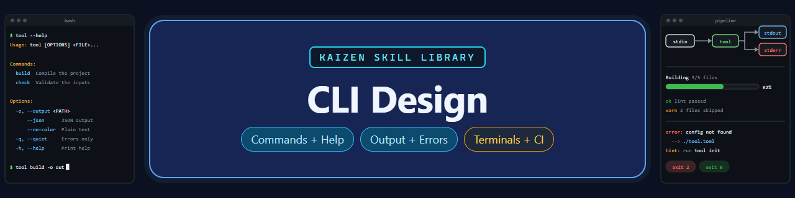

# CLI Design Agent Skill



Gives Claude Code, Codex and other coding agents design guidance for command-line tools used by people, scripts and CI jobs: arguments and flags, help text, output and streams, errors and exit codes, prompts, color, configuration and testing, with the differences between Unix/POSIX shells and Windows/PowerShell kept side by side.

**Status: early draft.** The reference pages are in place; scripts, assets and evaluations will be added over time.

## Install

```sh
npx skills add LevyBytes/AI-SKILL-cli-design -g
```

This installs the skill as `cli-design` for each coding agent it finds on your computer; without `-g` it goes into the current project only. The command needs Node.js 22.20 or later.

<details>
<summary>Install without Node.js</summary>

Clone the repository into your agent's skills folder:

| Agent | Command |
| --- | --- |
| Claude Code | `git clone https://github.com/LevyBytes/AI-SKILL-cli-design ~/.claude/skills/cli-design` |
| Codex | `git clone https://github.com/LevyBytes/AI-SKILL-cli-design ~/.agents/skills/cli-design` |

</details>

## Use

Ask your agent about a command-line tool as usual; it loads the skill when a task matches. You can also call it by name with `/cli-design` in Claude Code or `$cli-design` in Codex.

- "What do exit codes 126, 127 and 130 mean, and which codes should my CLI avoid reusing?"
- "Should `--help` print to stdout or stderr, and what exit status should it return?"
- "When should my CLI turn off color, and how does `NO_COLOR` interact with `FORCE_COLOR`?"
- "What is the difference between `--no-input` and `--yes` for a command that deletes files?"

## What's inside

Sixteen reference pages, one per design decision, and a Spanish translation of the streams and piping page.

| Area | Pages | Covers |
| --- | ---: | --- |
| Command shape: [arguments and flags](references/arguments-and-flags.md), [option parsing](references/option-parsing-and-platforms.md), [subcommands](references/subcommands-and-command-shape.md) | 3 | Operands, flag names, defaults, required options, secret input, repeated flags, globbing, Unix and PowerShell parsing, subcommand names and word order |
| Help and discovery: [help and usage](references/help-and-usage.md), [discovery and completion](references/discovery-completion-and-docs.md) | 2 | Usage syntax, examples, help streams and exit status, typo suggestions, shell completion, man pages |
| Output: [output and formatting](references/output-and-formatting.md), [color and styling](references/color-and-styling.md), [streams and piping](references/streams-and-piping.md), [progress and feedback](references/progress-and-feedback.md) | 4 | JSON and plain-text modes, tables, paging, verbosity, `NO_COLOR` and TTY detection, Windows VT, stdout and stderr, stdin and `-`, broken pipes, progress bars and spinners |
| Errors and interaction: [errors and exit codes](references/errors-and-exit-codes.md), [prompts and confirmation](references/prompts-and-confirmation.md), [interactivity, TTY and CI](references/interactivity-tty-and-ci.md) | 3 | Actionable errors, reserved and platform-specific exit codes, confirmation for destructive actions, `--no-input`, unattended runs, signals |
| Configuration and accessibility: [configuration and precedence](references/config-env-and-precedence.md), [accessibility and i18n](references/accessibility-and-i18n.md) | 2 | Flag, environment and file precedence, config locations, secrets, screen readers, output without color, locales and display widths |
| Review and testing: [testing CLI UX](references/testing-cli-ux.md), [design review checklist](references/cli-design-review.md) | 2 | Tests for exit codes, stdout, stderr, JSON and terminal behavior, a review checklist with findings by severity |

The [language selector](references/languages.md) lists the Spanish page and the English fallback.

## When agents load this skill

Use when designing, building, reviewing, or testing CLI commands, argument parsers, help, output, errors, prompts, configuration, shell completion, accessibility, or behavior in terminals, pipelines, and CI, including installer prompts on Unix and Windows/PowerShell.

## The work behind the references

The material is organized by interface decision rather than by a particular parser library. Focused references retain the Unix/POSIX and Windows/PowerShell distinctions, with examples for stream handling, output formats and error behavior.

## Contributing

Pull requests are accepted from approved contributors only. To propose a fix or a feature, first open an issue that describes the change your pull request would make, such as a guideline that is wrong or missing and the standard or documentation it should match. The maintainer reviews the issue and your GitHub account, then approves or declines. New maintainers are approved the same way. See [CONTRIBUTING](.github/CONTRIBUTING.md).

## Sources and license

Skill reference documentation is interpreted content for use in open source projects. Check against [official documentation sources](https://www.gnu.org/prep/standards/html_node/Command_002dLine-Interfaces) when dealing with defects or issues that may come up from interpreting this skill's references.

Licensed under **Apache-2.0**; see [LICENSE](LICENSE). Part of the [Agent Kaizen](https://github.com/LevyBytes/agent-kaizen) skill library.
