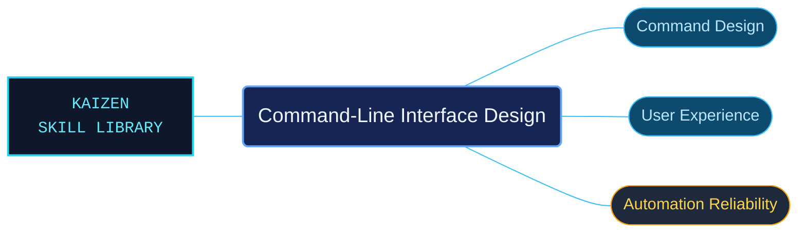

# Command-Line Interface Design

Practical design guidance for command-line tools used by people, scripts and CI jobs. The references connect command structure and help text with output contracts, errors, prompts and terminal behavior, making the package useful during both implementation and review.

Use when designing, building, reviewing, or testing CLI commands, argument parsers, help, output, errors, prompts, configuration, shell completion, accessibility, or behavior in terminals, pipelines, and CI, including installer prompts on Unix and Windows/PowerShell.

## What this skill helps with

| Task | Useful reference material |
| --- | --- |
| [Shape commands and options](references/arguments-and-flags.md) | Choose clear flags, operands and defaults, then follow the parsing and subcommand references. |
| [Make output usable in pipelines](references/streams-and-piping.md) | Separate stdout and stderr, handle stdin and account for broken pipes. |
| [Support terminals and automation](references/interactivity-tty-and-ci.md) | Design predictable behavior for TTYs, redirected streams and unattended execution. |
| [Review and test the interface](references/cli-design-review.md) | Evaluate an existing CLI with a structured checklist and linked UX testing guidance. |

## The work behind the references

The material is organized by interface decision rather than by a particular parser library. Focused references retain the Unix/POSIX and Windows/PowerShell distinctions, with examples for stream handling, output formats and error behavior.

## Start here

Start with [SKILL.md](SKILL.md) and follow its context routes.

Use the [reference index](references/INDEX.md) to select a design concern. The [language selector](references/languages.md) includes a Spanish streams-and-piping translation and identifies the English fallback for topics without a bundled translation.

## Sources and license

Skill reference documentation is interpreted content for use in open source projects. Check against [official documentation sources](https://www.gnu.org/prep/standards/html_node/Command_002dLine-Interfaces) when dealing with defects or issues that may come up from interpreting this skill's references.

Licensed under **Apache-2.0**; see [LICENSE](LICENSE). Part of the [Agent Kaizen](https://github.com/LevyBytes/agent-kaizen) skill library.
